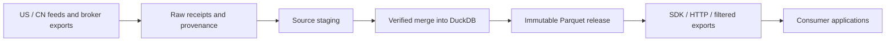

# Shared data providers

Provider adapters, ingestion, schemas, maintenance and verified delivery for
`dte_21_screener`, `qc_work` and other consumers. Strategies, screens, portfolio
risk and execution belong to those applications.

Active acquisition covers **US and mainland CN underlying price/volume and listed
options**, including actual futures contracts. Supporting calendars, corporate
actions and contract specifications are included. Other listing markets are out
of scope. Independent broker execution/journal maintenance remains authorized.

## Software and evidence status

The working release is **0.2.0.dev0**. Daily readiness assessment is implemented;
workflow migration, proof-bound delivery handoffs and effective-dated reference
qualification are proposals in [the v0.2 design](docs/V02_DESIGN.md). Software
version and a data-lake release identifier are different contracts.

For a new source checkout use `make setup`, then `make docs-check`, `make test`
and `make build`. These checks need no production warehouse. Installation alone
does not provide broker credentials, subscriptions, raw evidence or live datasets.
See [evidence access](docs/EVIDENCE.md) for public/private boundaries.

## Start here

| Task | Guide |
| --- | --- |
| Native Python setup, runtime paths and broker networking | [Native environment](docs/NATIVE.md) |
| Inspect progress, recover interrupted work, locate receipts | [Operations](docs/OPERATIONS.md) |
| Plan maintenance or refresh trading logs | [Maintenance](docs/MAINTENANCE.md) |
| Read, pin, export or serve data | [Data access](docs/DATA_ACCESS.md) |
| Understand stores, publication and ownership | [Architecture](docs/ARCHITECTURE.md) |
| Develop and validate changes | [Development](docs/DEVELOPMENT.md) |
| Find current requirements and preserved evidence | Requirements (private path `docs/requirements/README.md`; [access boundaries](docs/EVIDENCE.md#private-evidence)) |
| Take over the project and prepare a durable handoff | [Handover](docs/HANDOVER.md) |
| Look up configuration, commands and all datasets | [Configuration](docs/CONFIGURATION.md), [CLI](docs/CLI_REFERENCE.md), [Datasets](docs/DATASETS.md) |
| Browse all documentation | [Documentation index](docs/README.md) |

## Existing installation

From `/home/vic/data_providers`, inspect the native environment and available datasets
without starting downloads:

```bash
./scripts/native.sh data-providers datasets
./scripts/native.sh data-providers maintain --scope trades
```

If the environment needs installation or reconciliation, follow
[native setup](docs/NATIVE.md) and run `make setup`. Inspect active workers and
checkpoints in [Operations](docs/OPERATIONS.md) before starting maintenance.
Docker is not required; setup, tests, builds and maintenance run directly on Linux/WSL.

## Data flow and storage



The sole live runtime is `runtime/` in this checkout:
`/home/vic/data_providers/runtime` on the host. Code and storage roots are separate.
Use `data_providers.runtime` for ingestion and `MarketData(home=...)` for reads.
Do not recreate stores inside consumer projects.

Native jobs use `.venv-native` and private Python in `runtime/python` (or `.python-native` for a fresh setup).
The `.venv` compatibility symlink selects the native environment. Trading exports
are read directly from `/mnt/c/Users/victo/Documents/trading_logs` through the
configured `TRADING_LOGS_DIR`.

## Evidence and completion

A completed request can be empty or refused. Downloaded, verified merged and
published rows are different checkpoints. Publication verifies integrity; it does
not establish complete coverage, timeliness, NBBO eligibility or validated consumer
performance. See [validation](docs/VALIDATION.md) and source/method limitations.

[AGENTS.md](AGENTS.md) defines project working rules. The machine-readable
market scope (private path `docs/requirements/MARKET_DATA_SCOPE_20261019.json`; [access boundaries](docs/EVIDENCE.md#private-evidence)) overrides older
global inventories; historical evidence does not expand acquisition.
