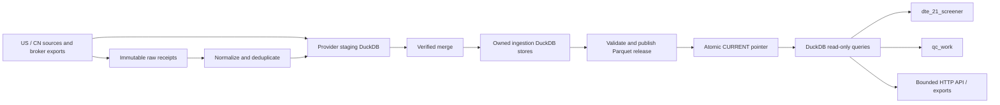
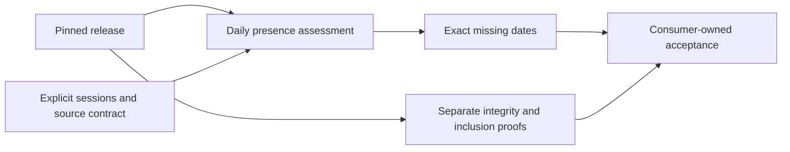

# DuckDB and Parquet data platform

This project owns source adapters, ingestion, normalization, data quality, provenance,
maintenance, and delivery. Applications own strategies, rankings, portfolios, and execution.



## Storage and responsibilities

| Layer | Location under the configured runtime | Purpose |
| --- | --- | --- |
| Original inputs | `var/raw/` | Original broker exports, hashes, modification times, provenance; source receipts are distinct from fills |
| Ingestion | `staging/*.duckdb` | Independent provider writers, resumable jobs, validation before merge |
| Curated writable state | Existing five DuckDB stores | Transactional upserts, constraints, source history, reference and trade ledger |
| Published analytical data | `lake/snapshots/<release>/.../*.parquet` | Immutable Zstandard Parquet; yearly by default, UTC-day for option quotes/intraday Greeks, source-month for IV v2 |
| Release catalog | `lake/snapshots/<release>/manifest.json` | Exact files, schemas, keys, counts, checksums, content signatures, provenance, logical dataset contracts |
| Active release | `lake/CURRENT` | One atomically replaced release identifier |
| External extracts | Caller-selected immutable directory | Filtered Parquet/CSV plus checksum manifest and originating release |

The existing runtime remains the only live warehouse. DuckDB ingestion files are
not moved or deleted. Parquet is the delivery representation of verified state,
not another independent ingestion system. The trade ledger stays transactional;
its optional private snapshot supports repeatable analytics rather than execution.

## Publication protocol

1. Take the maintenance and publication locks. Acquire read-only transactions on
   every source store before copying any table. An active DuckDB writer causes a
   visible failure; it cannot yield a half-new release.
2. Enumerate all tables and materialize legacy views. Preserve logical column order/types (including JSON and HUGEINT), declared primary keys,
   source fields, raw/adjusted prices, venue identities, and UTC timestamp semantics.
3. Partition temporal tables by year by default. Option quote/intraday Greek tables
   use UTC-day partitions; `iv_observations_v2` uses datasource/calendar month.
   Preserve null dates in a separate partition.
   JSON and 128-bit integers use lossless text encoding with logical type restoration;
   empty tables still have typed Parquet files. Undated tables use one partition.
   Readers use exact manifest paths, including older immutable layouts; they do not
   assume one universal partition granularity.
4. Reuse unchanged partitions by matching schema and unordered row signatures,
   then checking their SHA-256 and exact source multiset equality. Signatures combine row count, XOR, and 128-bit sum
   of DuckDB row hashes. They are an operational change detector, not a cryptographic
   equality proof. All reused and changed partitions undergo exact multiset comparison against
   their pinned source, in addition to type/count/signature checks.
5. Reject removed tables/columns, changed types, or changed primary keys unless
   an explicit `--allow-schema-change` migration is requested. Added columns are
   allowed and force affected table partitions to be rewritten.
6. Record per-file SHA-256, bytes, counts and signatures. Finish the manifest,
   rename the pending release, fsync files/directories, then atomically replace
   `CURRENT`. Every source table and view is represented in that release.

A failed build keeps `.incomplete-*` and `failure.json`; the previous `CURRENT`
remains readable. A completed but unpublished release is also safe to retain.
Existing releases are immutable and never automatically deleted. Later manifests
can reference unchanged files in earlier releases, so deleting an old directory
by age is unsafe. Garbage collection must trace all retained manifests first.

Publication provides a consistent captured set of local stores, not a claim that
all upstream feeds share one event time or have complete coverage. Consult source
maintenance results and individual dataset dates. A Saturday capture timestamp
is not a Friday market-bar timestamp.

## Delivery and compatibility

`MarketData()` automatically pins the current release at construction. A read or
export never follows a changing pointer midway through a query. `client.refresh()`
returns a new client; an explicit release remains pinned. The HTTP service creates
one reader per request and includes the release identifier in responses.

Before the first publication, automatic delivery uses existing read-only DuckDB
stores. Once a release exists, corruption or absent tables fail visibly rather
than silently returning live data. `backend="parquet"` requires a release;
`backend="duckdb"` explicitly selects live ingestion state for diagnostics.
`private=True` is still required for fill/account/export-row SDK datasets.
A release published without private data does not expose trade tables.
Filesystem access and HTTP bearer authentication remain the actual security boundary;
the Python flag is a guard against accidental disclosure, not a filesystem ACL.

Legacy module aliases remain the canonical Python module objects. Read-only
`data.db.connect` uses release views with the established `mh`, `ref`, `yh`, and
unqualified trade tables when the private release is available. Writer and staging
connections keep their existing behavior. Set `DATA_PROVIDERS_BACKEND=duckdb` for
legacy live-store diagnostics. The screener's CN board uses `connect_store(...,
"cn")`; explicitly supplied alternate test databases remain supported. QC's SDK
and export command acquire the same published data without provider dependencies.

## Operations

Use [Operations](OPERATIONS.md) for active checkpoints/recovery and
[Maintenance](MAINTENANCE.md) before executing a plan.

Run on the host from `/home/vic/data_providers` through the native environment:

```bash
./scripts/native.sh data-providers maintain --scope trades  # inspect a plan; see MAINTENANCE.md
./scripts/native.sh data-providers --private lake publish
./scripts/native.sh data-providers lake verify
./scripts/native.sh data-providers lake status
./scripts/native.sh data-providers --backend parquet read us_prices --symbol SPY --limit 5
./scripts/native.sh data-providers --release RELEASE_ID read cn_daily --symbol MA --limit 5
```

`--publish` runs only after successful supervised maintenance and after the writer
lock is released. Publication failure sets the overall result to failed and records
`summary.json`. Standalone publication is useful after independently recovered jobs
and a verified merge. It also refuses publication during a supervised maintenance run.
Do not publish while unmanaged writers are about to start: keep operational
maintenance serial through the supervisor. Source database locks provide a second guard.

For a reproducible rollback, start consumers with an explicit previously verified
release. Existing pinned clients remain valid through new publications. No automatic
retention policy destroys the files needed by such clients.

The platform preserves known source limits: expired rolling Sina windows and true
CN option-minute history are not reconstructed from daily bars. Broker-program
receipts are not added together as executions. Repeated source exports retain their
own provenance but normalize to the same fills.

## Implementation map

- `providers/`: transport adapters and source-specific behavior.
- `jobs/`, `warehouse/`: ingestion and maintenance entrypoints.
- `data/schema/`, `data/staging/`: transactional constraints and verified merges.
- `runtime.py`: configured storage roots, separate from application source roots.
- `catalog.py`: stable public/private dataset names and filter semantics.
- `lake.py`: immutable publication, release validation, DuckDB views.
- `client.py`, `server.py`, `cli.py`: bounded consumer interfaces and reproducible delivery.

Parquet row groups use DuckDB's 122,880-row default, with Zstandard compression;
column/date filtering can use DuckDB's Parquet projection and filter pushdown.
See [DuckDB Parquet guidance](https://duckdb.org/docs/current/data/parquet/tips)
and [Parquet query support](https://duckdb.org/docs/data/parquet).

## Readiness and evidence decisions

The SDK's readiness assessor operates on the same pinned reader as ordinary reads.
It aggregates matching rows by catalog symbol and UTC date, compares the exact
requested date set, and keeps live-store results provisional. Source and optional
method/model filters prevent accidental mixing. It does not acquire data, verify
raw receipts or advance an acceptance state. This small read-side layer avoids a
second ingestion store or a scheduler hidden inside consumer queries.



See [Readiness](READINESS.md) for bounds and [v0.2 design](V02_DESIGN.md) for
proposed workflow changes. Proposed lifecycle/reference stages are not implemented
by the presence API.

## Verification boundaries

Publication compares each selected source table/partition against its output
while source transactions are pinned, including exact multiset checks. Later
`lake verify` checks the immutable manifest/files, schemas, counts, signatures and
checksums; it does not compare a release with current mutable ingestion stores.
A delivery additionally needs exact selected-stage inclusion in that release.
Neither verification establishes upstream completeness or known historical
availability. See [Validation](VALIDATION.md) and [Handover](HANDOVER.md).
